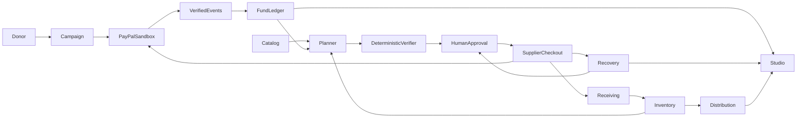

# Architecture and decision record

One Next.js 16.4/React 19/TypeScript App Router application, Node 22 target, Tailwind/accessibility primitives/Lucide, Supabase Postgres/Auth/RLS, Gemini 2.5 Flash via AI SDK with Zod validation, typed PayPal REST adapters, AG Studio React 3.0. Vercel Hobby for noncommercial sandbox; standard GitHub Actions public runners. Pin package versions/lockfile.

## Decisions

- ADR-001: Single application and data boundary; no speculative service fleet.
- ADR-002: Sandbox-only external payments. Receiving nonprofit merchant owns donations; receiving supplier merchant owns purchases/refunds. Operator configures known merchants server-side, never via public secret forms.
- ADR-003: Bounded AI planner with deterministic verifier/executor. Existing PayPal toolkit's older AI SDK dependency is not mixed into current agent SDK.
- ADR-004: Synthetic/public AI data; exclude names/emails/credentials/raw provider payloads/private organization data.
- ADR-005: Free services only, no paid fallback or automatic upgrades. Availability is quota-bound.
- ADR-006: Staff Google OAuth; isolated anonymous judge sessions, donor ownership and supplier identity independently scoped.
- ADR-007: Local synthetic simulation may exercise durable application behavior without credentials, but must visibly state that no PayPal transaction or model inference happened. Real integration failure never falls back to simulated success. Hosted requires durable Supabase persistence and secure session configuration.
- ADR-008: AG Studio local evaluation and Community grid fallback preserve local operation. The user has already supplied a trial stating November 25 expiry; the earlier plan to activate a trial around November 8 is superseded. Written rights and usable access through December 1–15 judging remain unresolved. Do not bundle/publish the key or bypass license enforcement. Community grid fallback alone does not establish STUDIO-01 sponsor qualification.

Funds are an operational subledger, not a PayPal wallet balance. Do not infer direct transfer of a donation into a later buyer payment. Independent sandbox merchant/buyer accounts and server operation ownership must be validated. Future live onboarding/payment rails, donor compliance and real deployment require separate authority and evidence.
